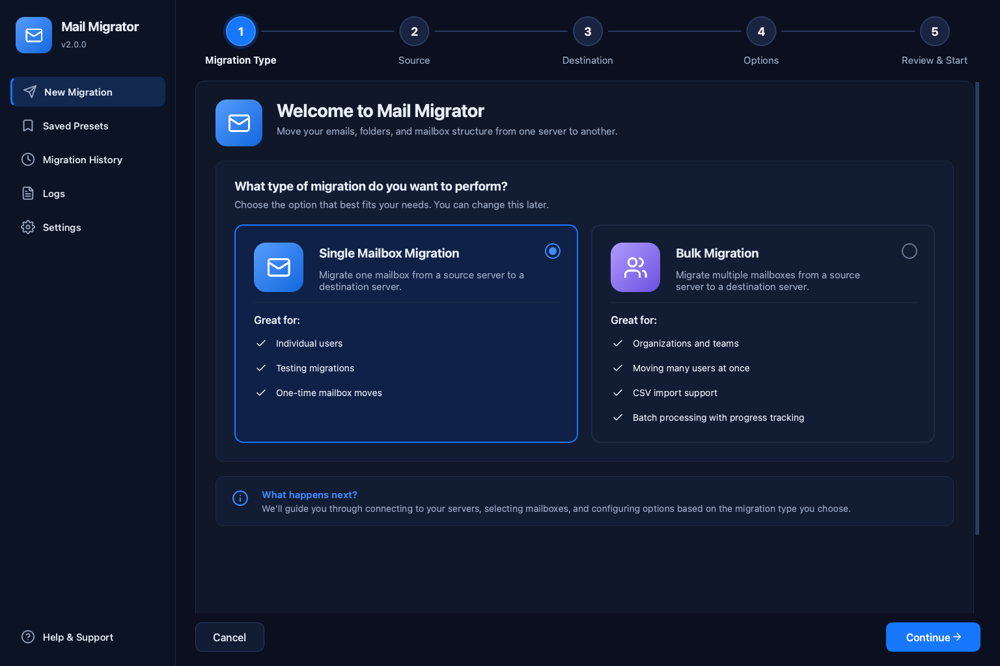
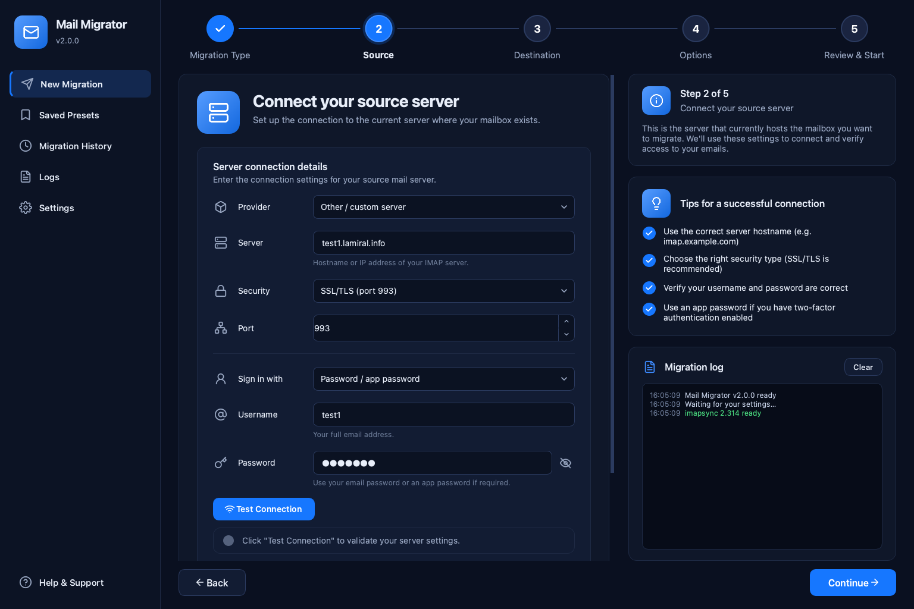
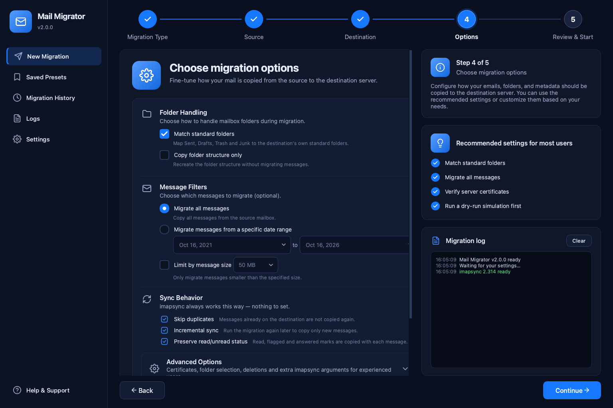
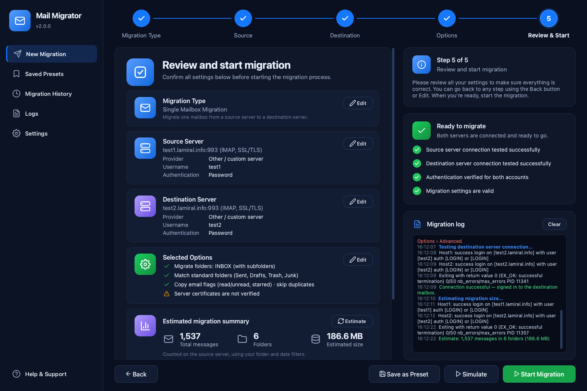
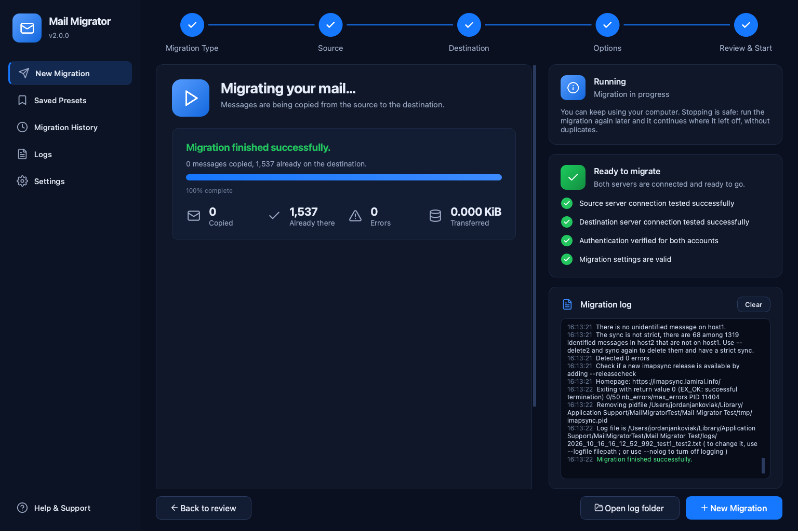
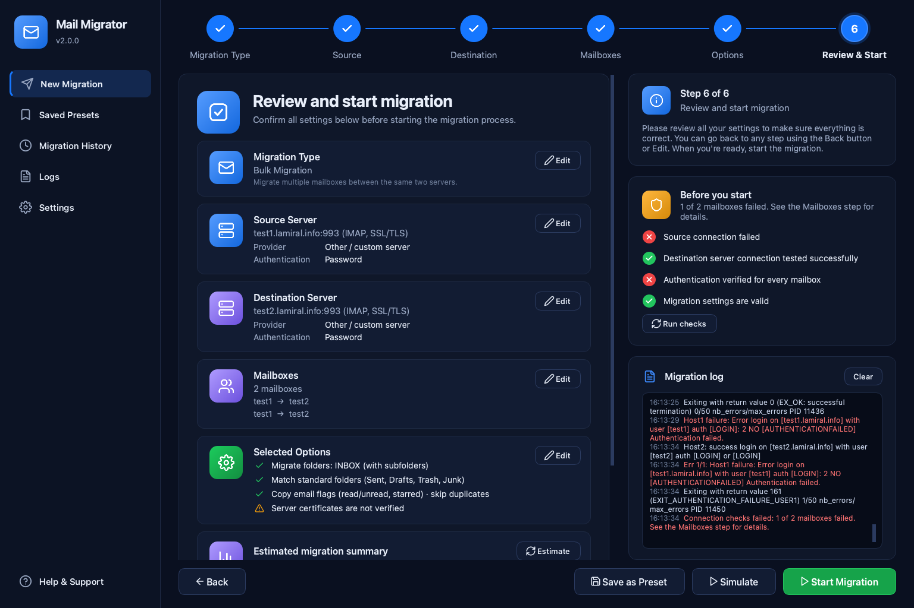

# Mail Migrator

**Move email from one mail server to another, with a friendly desktop app for
Windows, macOS and Linux.**

Mail Migrator copies every folder and message from one IMAP account to another,
whether you're moving one mailbox or hundreds. It's a graphical front end for
[imapsync](https://imapsync.lamiral.info/), the long-trusted migration engine
by Gilles Lamiral, and it bundles imapsync, so there's nothing else to install.



## Download

Get the latest version from the
[**Releases page**](../../releases/latest):

| Platform | File | First launch |
| --- | --- | --- |
| **Windows** 10/11 (64-bit) | `MailMigrator-*-windows-x64.zip` | Unzip, then run `Mail Migrator.exe`. If SmartScreen warns, choose *More info → Run anyway* (the app isn't code-signed). |
| **macOS** Apple Silicon (M1 and later) | `MailMigrator-*-macos-arm64.dmg` | Drag *Mail Migrator* to Applications. The first time, right-click it and choose *Open* (the app isn't notarized). |
| **macOS** Intel | `MailMigrator-*-macos-x64.dmg` | Same as above. |
| **Linux** x64 (Ubuntu 22.04+, Debian 12+, Fedora 36+) | `MailMigrator-*-linux-x64.tar.gz` | Extract, then run `MailMigrator/Mail Migrator`. |

## How it works

A short wizard takes you from start to finish:

1. **Migration type:** one mailbox, or many mailboxes in bulk (type them in
   or import a CSV file).
2. **Source:** the server your mail is on now. Pick a provider (Gmail,
   Microsoft 365, iCloud, Yahoo, Zoho, Fastmail, GoDaddy, …) or enter any IMAP
   server, then click **Test Connection**.
3. **Destination:** where the mail should go.
4. **Options:** match standard folders (Sent, Drafts, Trash, Junk), pick a
   date range, skip very large messages, and more.
5. **Review & Start:** see everything at a glance, **Estimate** the number of
   messages and the size, **Simulate** first, then **Start Migration**.

| Connect a server | Choose options |
| --- | --- |
|  |  |
| **Review before starting** | **Live progress and results** |
|  |  |

### Safe by default

- **Nothing is deleted** unless you turn on one of the two delete options, and
  both ask for confirmation.
- **No duplicates:** messages already at the destination are skipped, so you
  can stop at any time and run the migration again later to pick up only
  what's new.
- **Passwords are never saved.** They're handed to imapsync privately, never
  on the command line, and never written to presets, history or logs.
- **Server certificates are verified.** imapsync doesn't check them by
  default; Mail Migrator does, which protects your passwords from
  interception.
- **Full logs** of every run are kept and can be viewed in the app.

### Provider tips

- **Gmail, iCloud, Yahoo, AOL, Fastmail, Yandex:** use an *app password*, not
  your normal password.
- **Microsoft 365 / Outlook.com:** Microsoft no longer accepts plain passwords
  for IMAP. Choose *OAuth2 access token* and paste a token for the mailbox.

The app's **Help & Support** screen links to each provider's instructions.

## Bulk migrations

Choose **Bulk Migration**, then fill in the mailbox table or import a CSV file
with one mailbox per line:

```
user1;password1;user2;password2
alice@old-domain.com;old-password;alice@new-domain.com;new-password
```

Mailboxes are migrated one after the other, and each gets its own status and
log. **Run checks** on the review step signs in to every mailbox before you
start.



## For developers

The desktop app lives in [`gui/`](gui/): Python with Qt (PySide6). The
imapsync engine is the [`imapsync`](imapsync) Perl script at the top of this
repository, unchanged from upstream release 2.314.

```sh
# Run from source
cpanm --installdeps .                 # imapsync's Perl modules (see cpanfile)
cd gui
python3 -m pip install -r requirements.txt
python3 run_app.py
```

Builds for every platform run automatically in GitHub Actions
([`.github/workflows/build-apps.yml`](.github/workflows/build-apps.yml)), and
pushing a tag like `v2.0.0` publishes a release. To build on your own machine,
see [`gui/README.md`](gui/README.md).

### What changed compared with upstream imapsync

- A cross-platform desktop app (`gui/`).
- Standalone builds of imapsync for Windows, macOS (including Apple Silicon,
  which upstream doesn't ship) and Linux, with OpenSSL and certificate
  authorities bundled.
- A `cpanfile` listing every Perl dependency, for one-command installs.
- GitHub Actions workflows brought up to date.

Not included: imapsync's `oauth2/` helper scripts and `X/oauth2_example.html`,
because they contain the imapsync author's own OAuth app credentials. Get them
from [upstream imapsync](https://github.com/imapsync/imapsync) if you need them.

imapsync's own documentation is still here: [README](README), [FAQ.d/](FAQ.d)
and [INSTALL.d/](INSTALL.d).

## Credits and license

imapsync is written and maintained by
[Gilles Lamiral](https://imapsync.lamiral.info/) and released under the
[NOLIMIT Public License](LICENSE). If imapsync saves you time, consider
[supporting its author](https://imapsync.lamiral.info/#BUY).

Mail Migrator, the desktop app in `gui/`, is released under the same license.
